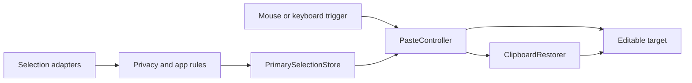

# Architecture

One native macOS app. Swift, AppKit and SwiftUI; no Node.js runtime or cloud service in the app.

## Runtime flow

Selection capture and paste execution are separate. The store retains payloads in memory; a successful paste commits queue/stack/cycle progress. UI previews follow the same policy.

## Ownership

| Area | Responsibility |
| --- | --- |
| `App` | Composition root, lifecycle and service ownership |
| `Features/Selection` | Capture, filtering and retained selections |
| `Features/Paste` | Target detection, request ordering and paste delivery |
| `Features/Clipboard` | Clipboard observation, temporary transport and restoration |
| `Features/Input` | Mouse event tap and optional keyboard shortcut |
| `Features/Permissions` | Accessibility, Input Monitoring and permission recovery |
| `Features/Settings`, `MenuBar`, `Support` | UI, controls and bounded diagnostics |
| `Infrastructure` | Preferences and launch at login |
| `Backend/Licensing` | Optional experimental server; disabled in the app |

`App` creates long-lived services and connects their callbacks. Settings receives state and actions; it does not create engines. Features can share domain types. Infrastructure does not depend on SwiftUI.

## Clipboard safety

- Direct insertion avoids the ordinary clipboard where the target supports it safely.
- Compatibility paste uses an exclusive transport operation. Temporary items are marked concealed/transient for clipboard managers.
- Restore only when the pasteboard still has our staged change count. Preserve a newer user copy.
- Materialize fresh pasteboard items for every publication. Compare rich payload data/types, not preview text.
- Recheck focus, target process and permissions before delivery. Incomplete web-editor ancestry uses normal paste rather than rewriting AXValue.

## Concurrency and privacy

App state and UI are main-actor-owned. Finder queries run off the main thread and carry a generation token; stale results are discarded after restart. Pending app-specific capture is cancelled on activation changes.

Typed diagnostics contain states, counts, types and error categories. Never log selected text, clipboard contents, file paths, raw Accessibility values or credentials. Support history holds at most 100 current-run events; no automatic off-device reporting.

## Verification

`make check` covers formatting, source rules, release metadata, CLI/packaging, backend checks, hostless XCTest and structural preflight. Automatic hosted CI is paused.

Core tests use isolated pasteboards and synthetic inputs. [Real-app acceptance](Compatibility.md) separately covers gestures, focus, permissions and target behavior. A universal binary proves compilation for two architectures; it does not prove Intel GUI acceptance.

[Developer setup](Developing.md) · [Privacy rules](Security.md) · [Release status](ReleaseReadiness.md)
