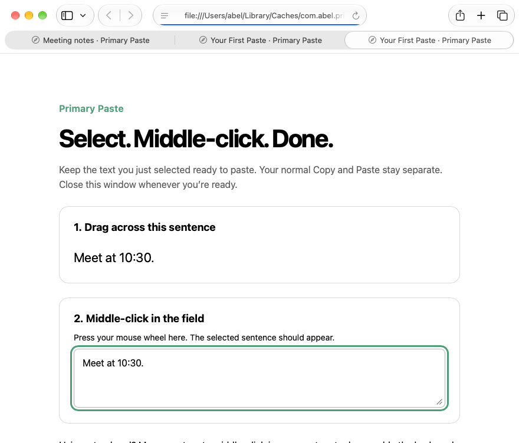

# Your first paste

Primary Paste keeps selected text separate from your normal ⌘C/⌘V clipboard.

## Set up once

Open the installed **Primary Paste.app** and follow Setup.

| Permission | Used for |
| --- | --- |
| Accessibility | Read selections and identify editable fields |
| Input Monitoring | Detect enabled global gestures and middle-clicks |
| Finder Automation | Optional file capture; off by default |

Grant access to one installed copy in a stable Applications location.

## Try it

Choose **Try It in Your Browser**. The practice page is local.

1. Drag-select the sentence.
2. Middle-click its text field, usually by pressing your mouse wheel.
3. Check the result, then choose **Continue in Menu Bar**.

With a trackpad, map a gesture to middle-click or enable **⌃⌥⌘V** in Paste. The keyboard shortcut pastes into the focused field.

## Everyday use

- **Latest:** paste the newest selection. Queue, Stack and Cycle keep several.
- **Separate:** the default clipboard mode. Import Copies and Mirror Selections deliberately link the buffers.
- **Private Mode:** stop new capture and imports. Existing items can still be pasted.
- **Clear Primary:** remove retained items. Pause capture or block an app from the menu bar.

## Nothing appeared?

1. Reopen Setup. Check permissions and service status; retry a stopped service.
2. Drag-select fresh text. Automatically selected address bars do not count in Safe Drag.
3. Use an editable field and check neither app is blocked or set to pass-through.
4. Check [Compatibility](Compatibility.md) for an app rule or known limitation.

After a signing change, quit the app and update its permission entry in System Settings. [Installation help](Install.md).
