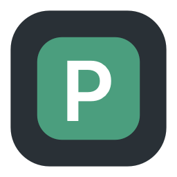
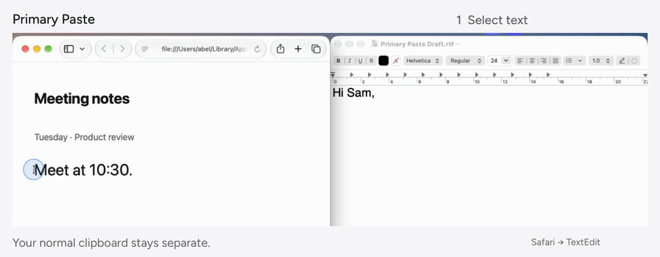
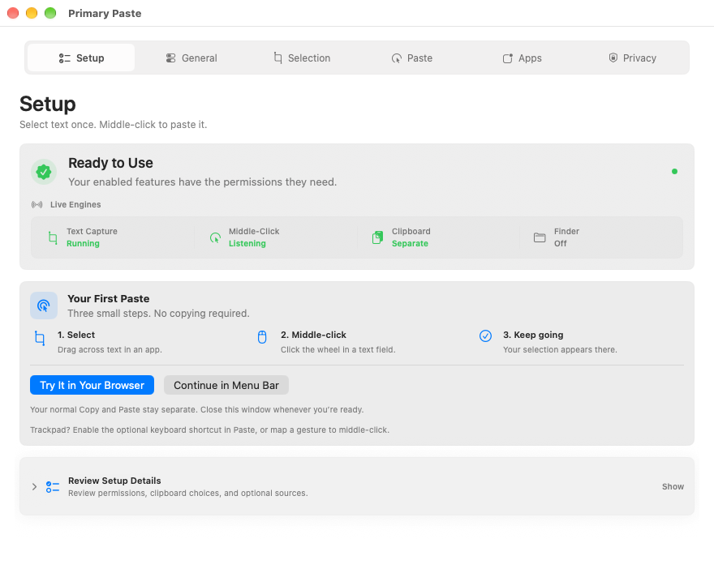

<p align="center"></p>
<h1 align="center">Primary Paste</h1>
<p align="center"><strong>Select text. Middle-click to paste.</strong><br>A separate selection clipboard for macOS.</p>
<p align="center">
  <a href="Docs/Install.md"></a>
  <a href="Docs/ReleaseReadiness.md"></a>
  <a href="LICENSE"></a>
  <a href="CONTRIBUTING.md"></a>
</p>



[Watch the demo](Docs/Media/Explainer/Primary-Paste.mp4) · [Set up](Docs/GettingStarted.md) · [Compatibility](Docs/Compatibility.md) · [Report an issue](https://github.com/machineyearningengineer/primary-paste/issues)

Drag-select text in one app, then middle-click an editable field in another. Your normal ⌘C/⌘V clipboard stays separate.

- **Local:** selections stay in memory. No account or subscription.
- **Familiar:** links and tabs keep their normal middle-click behavior.
- **Under your control:** pause capture, clear selections or exclude apps.
- **More than one item:** choose Latest, Queue, Stack or Cycle.

## Install

**Source preview · 0.1.0, build 3.** [Preview downloads and SHA-256 checksums](https://github.com/machineyearningengineer/primary-paste/releases) are for inspection: they are unsigned and not notarized. No Homebrew or npm installer is published. [Release status](Docs/ReleaseReadiness.md).

Build locally with full Xcode:

```sh
git clone https://github.com/machineyearningengineer/primary-paste.git
cd primary-paste
make build
```

To install a local development copy, follow [developer setup](Docs/Developing.md). The app requires macOS 14+; Node.js is only needed for development checks or the optional npm launcher.

## First paste

1. Open Primary Paste and follow Setup to grant the required permissions.
2. Choose **Try It in Your Browser**. Select the sentence, then middle-click the field.
3. Choose **Continue in Menu Bar**.

Trackpad? Enable the optional **⌃⌥⌘V** shortcut in Paste, or map a gesture to middle-click.



Chrome, Edge, Safari, Maccy, CopyQ and Codex’s local composer have recorded VM checks. Some fields need app rules. Authenticated Codex, signed-in Arc and Intel runtime remain unverified. [Tested versions and limits](Docs/Compatibility.md).

## Developers

```sh
make check     # Complete local quality gate
make build     # Compile without signing or opening windows
```

[Setup](Docs/Developing.md) · [Architecture](Docs/Architecture.md) · [Release process](Docs/Releasing.md) · [Changelog](CHANGELOG.md)

Checks run locally. Automatic GitHub Actions are paused; no CI minutes are required to build or test.

Issues are welcome; external PRs are closed during the initial preview. Verify AI-assisted reports before submitting. [Contributing](CONTRIBUTING.md).

GPL-3.0-only. Distributed changes must include corresponding source; commercial forks are allowed. [License and branding](Docs/Licensing.md) · [Privacy](Docs/Security.md) · [Media rights](Docs/Media/Rights.md).
